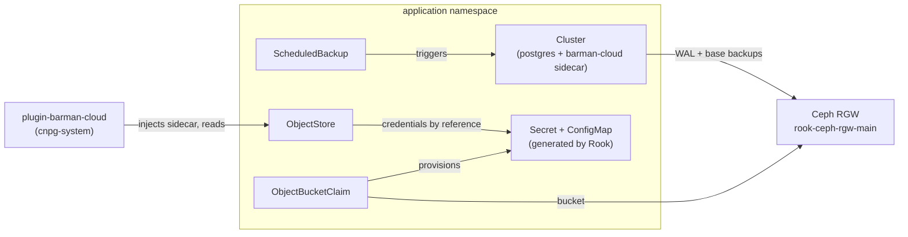

# Architecture

The cluster is reconciled by Argo CD from this repository; the layout and the
validation checks are in the [README](README.md). This file explains the
design choices that the manifests alone do not.

## PostgreSQL backups

Every PostgreSQL database runs as a CloudNativePG `Cluster`. Each one ships its
WAL continuously and a daily base backup to its own bucket in the Ceph object
store, which gives point-in-time recovery over the retention window.

### Components

- **`plugin-barman-cloud`** ([applications/cnpg-system/plugin-barman-cloud.yaml](applications/cnpg-system/plugin-barman-cloud.yaml))
  runs beside the operator in `cnpg-system`. It owns the `ObjectStore` CRD
  and injects the `plugin-barman-cloud` sidecar into every instance pod of a
  `Cluster` that lists it in `spec.plugins`. The sidecar runs
  `barman-cloud-wal-archive`, `barman-cloud-backup` and the retention
  cleanup; the plugin Deployment itself moves no data.
- **One `ObjectBucketClaim` per database**, named `<cluster>-backups`, with a
  fixed `bucketName` of the same name. Rook creates the bucket, a dedicated RGW
  user, and a `Secret` and `ConfigMap` of that name in the claim's namespace.
- **One `ObjectStore` per database**, also `<cluster>-backups`, pointing at
  that bucket and reading the access keys from the Rook `Secret` by reference.
  It holds the retention policy, the compression settings and the sidecar's
  resources.
- **One `ScheduledBackup` per database**, `<cluster>-daily`.

All four live next to the `Cluster` in its application's `manifests/`
directory, so a database and its backups are synced, reviewed and removed
together.

### Design decisions

- **The Barman Cloud plugin, not `spec.backup.barmanObjectStore`.** The
  in-tree Barman Cloud support is deprecated since CloudNativePG 1.26 and
  removed in 1.32; the plugin is the supported path from 1.30 on, with the same
  `barman-cloud` tooling and the same object layout underneath.
- **A bucket and a credential per database, not a shared bucket.** Each RGW
  user can read and delete only its own database's backups, a restore points at
  one bucket with no prefix to get right, and removing one database's backups
  is deleting one bucket.
- **Buckets come from `rook-ceph-bucket-main-retain`.** The shared
  `rook-ceph-bucket-main` class deletes the bucket with its claim, so deleting
  an application or its namespace would take the database and every copy of it
  in one step. With `Retain`, the bucket and its objects survive the claim
  and are removed by hand.
- **Sync waves order the pieces inside one Application.** The claim and the
  `ObjectStore` are in wave `-1`: Argo CD waits for the claim to be `Bound`
  (its built-in health check) before it touches the `Cluster`, so the sidecar
  never starts without credentials. The `ScheduledBackup` is in wave `1`,
  after the `Cluster` is healthy again, and its `immediate: true` first backup
  then runs against a working WAL archive.
- **Retention is a 30-day recovery window**, enforced by the sidecar
  (`barman-cloud-backup-delete`): any point in the last 30 days is
  recoverable, and the newest base backup older than that is kept as its
  starting point.
- **`zstd` for the WAL, `gzip` for base backups.** CloudNativePG forces a WAL
  switch every 5 minutes (`archive_timeout`), so an idle database still ships
  288 mostly-empty 16 MiB segments a day: they need a cheap codec, and `zstd`
  shrinks them to next to nothing. A base backup runs once a night, where
  `gzip`'s slower compression costs nothing and buys a better ratio and the
  fastest restore of the codecs Barman documents.
- **Schedules are staggered 15 minutes apart from 02:00 UTC**, so the base
  backups do not all hit RGW at once.

### Invariants

- The `ObjectStore`'s `destinationPath` and the claim's `bucketName` name the
  same bucket. The bucket name is fixed rather than generated because the
  `ObjectStore` cannot read it from the claim's `ConfigMap`.
- `serverName` is left unset everywhere: the backups of a `Cluster` sit under
  `s3://<cluster>-backups/<cluster>/`, which is what a recovery's
  `externalClusters` entry expects by default.
- The plugin must be installed before any `ObjectStore` or `Cluster` that
  references it is synced: the CRD comes with it.

### Limitations

- `wodtrack-pg` and `ai-registry-postgres` are rendered by their application
  charts, which expose no `spec.plugins` value. Their claim and `ObjectStore`
  exist; WAL archiving and the `ScheduledBackup` need the chart to accept the
  plugin configuration.
- A backup lives in the same Ceph cluster as the database it protects. It
  covers a lost volume, a bad migration or a dropped table, not the loss of
  the Ceph cluster itself.
